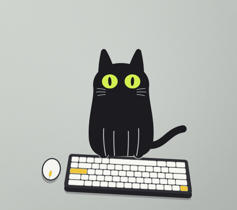
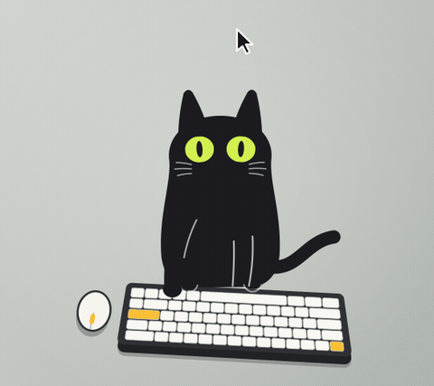
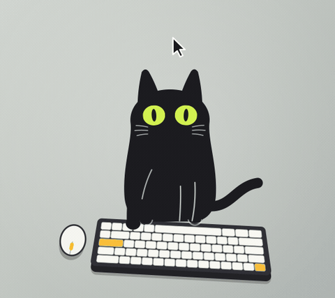
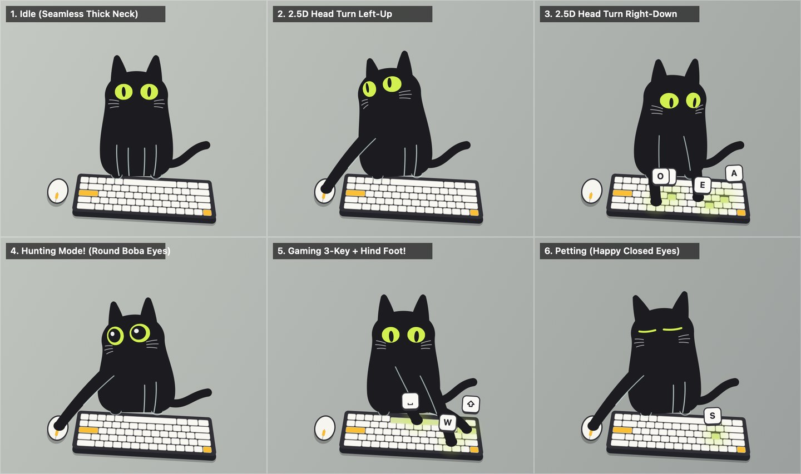
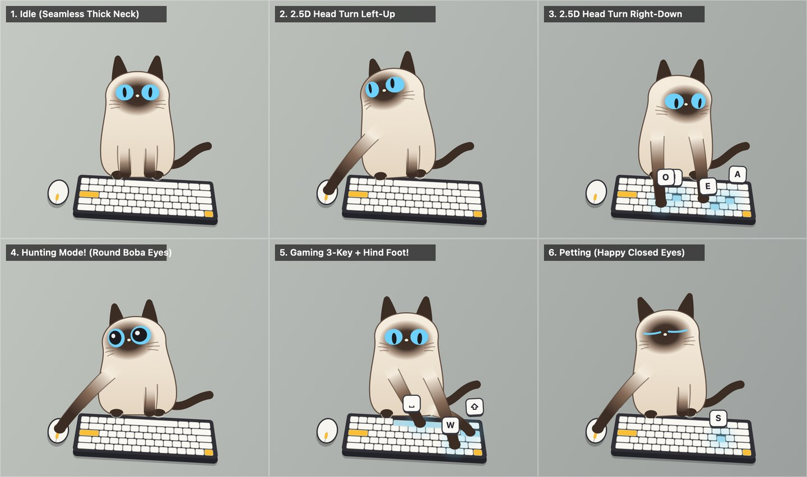

# 🐱 KuroCat — 全状态键盘鼠标桌面萌猫 (macOS & Windows)

<p align="center">
  
  
  
</p>

<p align="center">
  <b>超轻量级原生桌面宠物 · 打字 & 玩游戏全状态硬件级监听 · 2.5D 球面转头 · 捕猎大圆眼 · 双皮肤自由切换</b><br/>
  Native macOS (Swift + AppKit/CoreGraphics + IOHIDManager) & Windows (C++17 + Win32/GDI+ + Raw Input)
</p>

---

## ✨ 特性亮点

- **🎮 打字 & 玩游戏全状态接收（真正全键无冲 NKRO）**
  - **macOS**：双层架构 `IOHIDManager`（内核 HID 硬件层）+ `CGEventTap`，不受中英文输入法干扰，完整支持游戏里长按 `WASD`、组合快捷键、单独修饰键（`⌘ / ⇧ / ⌥ / ⌃ / Fn`）、方向键与 `F1–F12`。
  - **Windows**：原生 `Raw Input API (RIDEV_INPUTSINK)` 硬件扫描码监听，打字与 DirectX/Vulkan 游戏内按键、鼠标锁定微动均可全局捕获。
- **🌀 2.5D 球面转头 & 真实面向视角**
  - 采用 Live2D 同款球面投影算法，猫头、双耳、双眼与胡须随鼠标光标产生真实的 2.5D 透视转头与视差；键盘与鼠标 180° 朝向小猫摆放，玩游戏时左手键盘、右手鼠标自然不交叉。
- **⚡ 捕猎大圆眼模式**
  - 快速晃动鼠标时，小猫瞳孔从竖瞳逐渐扩张为超大圆润黑瞳 + 白色高光，身子压低伏击、尾巴加快抽动、全程锁敌不眨眼。
- **🐾 丰富交互彩蛋**
  - **3 键同时按「用脚按」**：同时按住 3 个及以上按键时，小猫会翘起后脚踩上第 3 个键！
  - **摸头/摸背互动**：鼠标轻撸猫头会露出惬意闭眼 `— —` 与微光粒子，闲置久了还会打瞌睡冒 `z`。
  - **智能鼠标穿透**：透明区域自动穿透不挡操作；玩竞技游戏时可一键开启「完全鼠标穿透（游戏防误触）」。
- **🎨 双皮肤 & 多配色自由搭配**
  - **猫咪皮肤**：经典小黑猫（原版荧光黄绿瞳）/ 挖煤暹罗猫（暖燕麦奶白 + 2.5D 焦糖面罩 + 巧克力小袜子 + 宝石蓝瞳）
  - **键盘配色**：经典奶白暖黄 / 暗夜极客黑 / 复古奶油灰
  - **瞳色与缩放**：4 种瞳色、5 档尺寸缩放、今日击键与实时 KPM 统计。

### 双皮肤 6 态预览

| 经典小黑猫 | 挖煤暹罗猫 |
| :---: | :---: |
|  |  |

---

## 📦 下载与运行

前往右侧 **[Releases](../../releases)** 页面直接下载对应系统版本（由 GitHub Actions 自动编译）：

### 🍎 macOS (Apple Silicon & Intel 通用 · macOS 13+)
1. 下载 `KuroCat-macOS-universal.zip` 解压，将 `KuroCat.app` 拖入「应用程序」打开（常驻顶部菜单栏，不占 Dock）。
2. 首次使用点击小猫底部提示胶囊，前往 **系统设置 → 隐私与安全性 → 输入监控** 勾选 `KuroCat` 后在菜单栏点「重启 KuroCat」即可全局监听打字与游戏按键。

**本地源码编译：**
```bash
chmod +x build.sh
./build.sh
open KuroCat.app
```

### 🪟 Windows (Windows 10 / 11 x64)
1. 下载单文件 `KuroCat-Windows-x64.exe`（约 300 KB，**零外部运行时依赖**），双击即可运行，常驻右下角系统托盘。
2. 右键小猫或右键托盘小猫图标即可切换皮肤、键盘配色、尺寸、游戏防误触穿透模式等。
   > 若部分网游以管理员权限运行，右键「以管理员身份运行」`KuroCat.exe` 即可同步捕获游戏内按键。

**本地源码编译（MSVC / MinGW）：**
```bat
cd windows
build.bat
```
或使用 CMake：
```bat
cd windows
cmake -B build && cmake --build build --config Release
```

---

## 📁 项目结构

```text
KuroCat/
├── Sources/                   # macOS 原生 Swift 源码 (AppKit + CoreGraphics + IOHIDManager)
├── Resources/Info.plist       # macOS Bundle 配置
├── build.sh                   # macOS 一键编译脚本
├── windows/
│   ├── src/
│   │   ├── KeyMap.hpp         # 65% 朝猫键位映射 & Windows 硬件扫描码表
│   │   ├── InputEngine.hpp    # Windows Raw Input API 全状态键盘/鼠标引擎
│   │   ├── CatPhysics.hpp     # 60fps 弹簧物理、2.5D 转头、捕猎大圆眼、3 键用脚按
│   │   ├── CatRenderer.hpp    # GDI+ 32-bit 透明抗锯齿矢量渲染器（黑猫 + 暹罗）
│   │   └── main.cpp           # Win32 LayeredWindow、智能穿透、托盘菜单、注册表配置
│   ├── app.manifest           # Per-Monitor V2 高分屏 DPI 适配
│   ├── build.bat              # Windows 一键编译脚本
│   └── CMakeLists.txt
└── .github/workflows/build.yml # macOS & Windows 双平台自动构建与发版工作流
```

---

## 🔒 隐私说明

KuroCat 的所有键盘与鼠标硬件信号**仅在本地内存实时驱动桌宠动画与计数**，**绝不记录按键内容、绝不写日志、零联网请求**，全部源码完全开源可审计。

## 📄 License

[MIT License](LICENSE)
